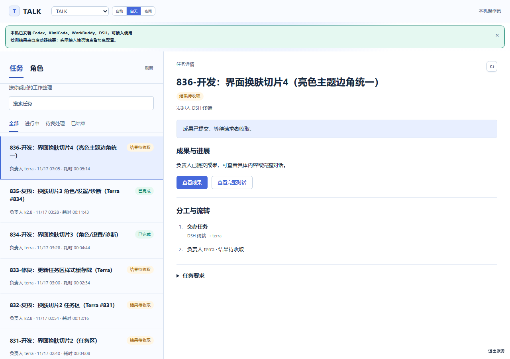
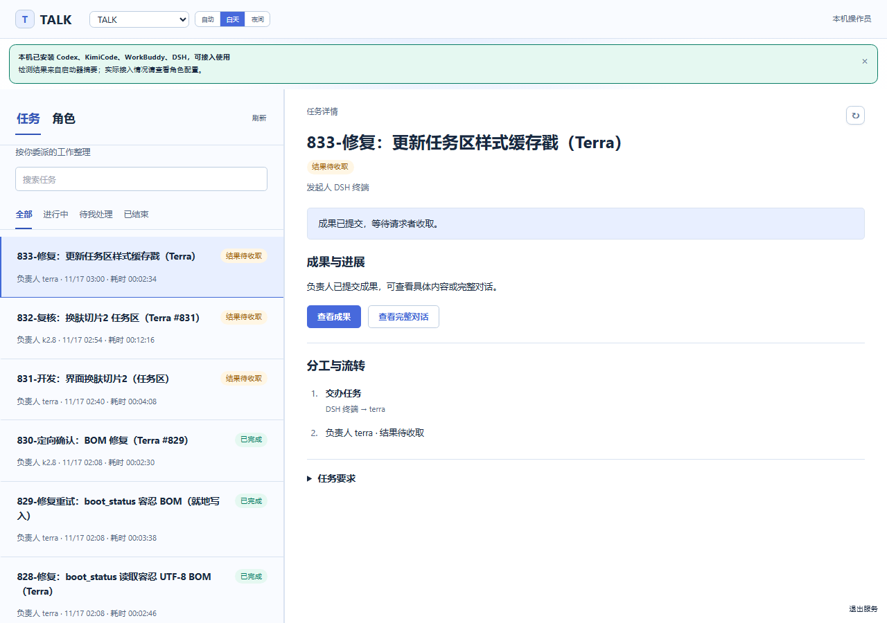
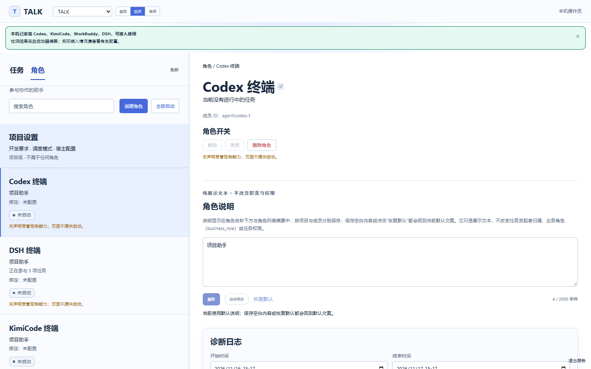

# TALK

家庭局域网里，人、Agent 与 Agent 之间的聊天与任务协作平台。一个文件夹，双击即用。

> TALK — a local-first chat & task workspace where humans and AI coding agents work together.
> Windows x64 portable package, no Python required.



## 为什么用 TALK

**多任务独立推进，不必一次想清全部需求。** 协调者用多轮对话持续安排工作，每条线路都有自己的任务记录、交付与验收，不用把整个项目压在一次任务执行里。可以边做边补需求，更接近真实的开发方式。

**等待任务时人不必闲着。** 任务派出去后，你可以继续讨论需求、调整优先级、安排其它线路；需要你拍板时，Agent 会停下来提问，而不是闷头做错方向。

**按需启动，空闲不占资源。** 只为需要运行的角色保留后台宿主；本轮启动过的角色即使关掉也保留宿主，下次启动更快；重启时只拉起勾选了「随项目自动启动」的角色。本机实测：冷启动 2 个勾选角色，手动启动一个未勾选角色约 10–11 秒就绪。



## 功能亮点

| 亮点 | 说明 |
|---|---|
| 多任务并行 | 多任务独立推进，每条线路有自己的任务记录、交付与验收 |
| 主被动双模式 | **主动**：派发后由后台程序轮询，等待期不调用模型（0 token），就绪即通知取件；**被动**：派发后结束本轮，等待期间可继续讨论、安排其它任务。主动模式**当前仅在 DSH 终端验证通过**，其它终端尚未验证 |
| 同模型多角色 | 同一运行器/模型可以建多个角色（如两个 K2.8 分工，或同模型分 dev / reviewer），各自独立身份、绑定、原生会话与任务队列，删一个不影响另一个 |
| 任务交付闭环 | Task Hall：派发 → 执行 → 结构化交付 → 复核，全程留痕、结果可收取 |
| 澄清与验收 | 澄清有额度，用尽转人工决策；任务树、Review、里程碑 Test 同处追踪 |
| 多运行器同台 | Codex / KimiCode / DSH / WorkBuddy，角色可选模型与思考强度 |
| 工作区隔离 | 多项目并行，切换工作区不打断正在跑的任务 |
| 按需启动 | 只为需要运行的角色保留宿主，空闲不占资源 |
| 开箱即用 | 解压双击、明暗主题、无地址栏窗口、「退出服务」一键停整机 |

> 同模型多角色互评时，模型判断偏差往往一致；严肃验收建议混搭不同厂商的模型。



## 快速开始（Windows x64，免安装）

1. 到 [Releases](https://github.com/bobo506/TALK/releases/tag/v0.1.0) 下载 `TALK-portable-0.1.0.zip`；
2. 解压到任意可写目录（建议非系统盘，避开 OneDrive 同步目录）；
3. 双击 `start-gui.bat`；
4. 首次启动自动生成 `config/`、`data/`、`data/keys/operator.key`、默认项目与管理员 `human:operator`；
5. 应用窗口打开即可使用。

**关闭窗口不会停止服务**。停止方式：页面右上角「退出服务」（有任务在跑时会提示等待），或运行 `stop.bat`；`status.bat` 查看状态。

## 系统要求

- Windows 10/11 x64（包内自带 Python 3.12，无需安装）；
- Chrome 或 Edge（优先 Chrome 应用窗口，其次 Edge，都没有时用系统默认浏览器）；
- 至少一个已登录的运行器：Codex CLI / KimiCode CLI / DSH / WorkBuddy。

## 数据、Key 与备份

| 路径 | 内容 |
|---|---|
| `data/talk.db` | 聊天记录、任务、角色绑定 |
| `data/keys/` | 管理员与角色 Key（含 `operator.key`） |
| `data/storage/` | 上传的文件 |

- 备份：复制整个 `data/`；
- 换机：新机器解压同版本包 → `stop.bat` → 用旧 `data/` 覆盖新包的 `data/` → 启动；
- 整个文件夹被复制或转发时 **Key 会一并被带走**；需要隔离就把 `TALK_KEYS_DIR` 指向包外目录。

## 让家里其它设备访问

默认只监听 `127.0.0.1:8000`。编辑 `<包>/config/config.toml`：

```toml
[server]
host = "0.0.0.0"
port = 8000
public_url = "http://<本机局域网IP>:8000"
trusted_networks = ["loopback", "private"]
```

改完 `stop.bat` → `start-gui.bat`，其它设备打开 `http://<本机IP>:8000`。若不加 `private`，其它设备访问需携带管理员 Key。

## 常见问题

| 现象 | 处理 |
|---|---|
| 双击没反应 / 没有窗口 | 看 `logs/launcher/`、`data/logs/` 下的日志；确认没被杀软拦截 |
| 8000 端口被占用 | `status.bat` 确认后停掉占用程序，或改 `config/config.toml` 的 `port` |
| 关了窗口服务还在跑 | 设计如此，用「退出服务」或 `stop.bat` |
| 提示未检测到运行器 | 安装 Codex / KimiCode / DSH / WorkBuddy 任一后重启 TALK |
| 角色一直在配置中 | 对应运行器需在本机完成原生登录；角色页可看准备状态与原因 |

## 从源码运行（开发）

```bash
pip install -r requirements.txt
python -m uvicorn server.main:app --host 127.0.0.1 --port 8000 --reload
```

也可以用 Docker：`docker compose up -d`（用的是仓库根目录的 `config.toml` 与仓库内数据，布局与便携包不同，不要混用同一份数据）。

## 文档

- 家庭用户快速开始：[docs/guides/QUICKSTART_USER.md](docs/guides/QUICKSTART_USER.md)
- 用户手册：[docs/guides/USER_MANUAL.md](docs/guides/USER_MANUAL.md)
- 便携版说明 / 交接：[PORTABLE_PACKAGE.md](docs/guides/PORTABLE_PACKAGE.md) · [PORTABLE_HANDOVER.md](docs/guides/PORTABLE_HANDOVER.md)
- Agent 接入：[docs/guides/QUICKSTART_AGENT.md](docs/guides/QUICKSTART_AGENT.md)
- 部署：[docs/guides/DEPLOY.md](docs/guides/DEPLOY.md)
- 交互框架设计（面向技术讨论）：[docs/spec/INTERACTION_FRAMEWORK.md](docs/spec/INTERACTION_FRAMEWORK.md)

## 已知限制

- 仅提供 Windows x64 分发包；未在第二台干净机器验证首次启动，未验证跨版本升级迁移；
- macOS / Linux 目前只有源码与 Docker 方式，桌面启动器未端到端验证；
- 主动模式目前只在 DSH 终端验证通过，其它终端尚未验证；
- 不写注册表、不装 Windows 服务，删文件夹即卸载。

## 许可

MIT License，见 [LICENSE](LICENSE)。
